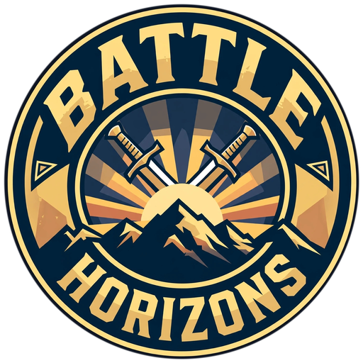

<p align="center">
  
</p>

# Battle Horizons: Last Survive

Offline Android battle-royale prototype built with **Unity 6 `6000.0.85f2` and URP**.
The only game-engine project in this repository is `unity-project/`.

> No on-device FPS, memory or thermal result is claimed. A test APK is considered
> available only when a Unity build actually completes and uploads an artifact.

## Project setup

1. Install Unity `6000.0.85f2` with Android Build Support (SDK/NDK and OpenJDK).
2. Clone with Git LFS enabled, then open `unity-project/` in Unity Hub.
3. Run **Battle Horizons > Project Setup > Configure**. This creates the URP
   assets, materials, runtime scenes, Android settings and a black startup/loading
   screen.
4. Play the generated MainMenu or PlayerTest scene.

## Build an Android test APK

From the Unity editor, use **Battle Horizons > Build > Android APK** after project
setup. The default output is `unity-project/Builds/battle-horizons.apk`; without a
release keystore it is debug-signed for testing only.

GitHub Actions provides two GameCI workflows:

* [`.github/workflows/unity.yml`](.github/workflows/unity.yml) runs repository,
  map-data and Blender checks, then configures/tests Unity when a supported
  license is present. Its editor steps require `UNITY_LICENSE`, `UNITY_EMAIL`,
  and `UNITY_PASSWORD` for Personal, or `UNITY_SERIAL`, `UNITY_EMAIL`, and
  `UNITY_PASSWORD` for Professional. Email/password alone are not enough.
* [`.github/workflows/build.yml`](.github/workflows/build.yml) builds the Android
  APK with an online Personal activation. It requires `UNITY_EMAIL` and
  `UNITY_PASSWORD`; Buildalon creates the runner's `.ulf` and passes its masked
  contents to GameCI at runtime, so this workflow does not need a stored
  `UNITY_LICENSE` secret. It has no pull-request trigger because it consumes
  Unity account credentials.

Run **Build Android APK** manually after configuring the Unity secrets. Optional
release signing accepts `ANDROID_KEYSTORE_BASE64`, `ANDROID_KEYSTORE_PASS`,
`ANDROID_KEYALIAS_NAME`, and `ANDROID_KEYALIAS_PASS`; the previous `KEYSTORE_*`
secret names are also accepted. If signing values are omitted, the result is a
debug-signed test APK and must not be published to a store. Pushing a `v*` tag
creates or updates a GitHub Release named **Battle Horizons: Last Survive (Build
#N)** and attaches the signed APK; this release step is skipped unless all four
signing secrets are present. The build name remains `BattleHorizons`, and the
workflow artifact is named `BattleHorizons-Android-APK-N`.

## Siran Island, terrain LODs and 50 m streaming

The committed Unity data lives under
`unity-project/Assets/Resources/Config/`. It describes a 4 km island on a 401 ×
401 height/color grid, partitioned into 500 m source tiles.

The ground is drawn as two complementary levels of detail, both matte
(`metallic 0`, `smoothness 0`) and both cut by the same world-space circle:

* **inside 50 m** — the streamed 500 m tiles at the full 10 m sample spacing
  (only tile rectangles intersecting the circle are resident). This is also the
  surface the `TerrainCollider` matches, so the player never floats or sinks;
* **outside 50 m** — one static 20 m full-island shell (201 × 201 vertices,
  80,000 triangles, a single draw call) that shows the hills, flat zone pads,
  coastline and inland lake out to the view distance.

The `SiranRadiusClip` shader draws the detail disk only inside the circle and the
shell only outside it, so the two never overlap or z-fight. The Unity `Terrain`
renderer (`drawHeightmap`) stays disabled; its heightmap collider covers the
whole map. The sea, lake and river are unclipped so the island reads as an island
rather than a floating circle. See
[`docs/architecture/UNITY_ARCHITECTURE.md`](docs/architecture/UNITY_ARCHITECTURE.md).

Your own buildings, trees and props go in `unity-project/Assets/UserAssets/Models`
and `.../Materials`; nothing is spawned there by the project.

The map data is authoritative in Unity; no separate engine project or conversion
step is required. Validate the committed blobs and hashes with:

```bash
python3 processing/unity/validate_unity_map.py
```

## Offline and mobile settings

The Android target is ARM64, landscape, ASTC-compressed and does not request a
forced INTERNET permission. Low and High quality profiles adjust render scale,
shadows, view distance and frame pacing; both keep the same 50 m detail-disk
radius. These
are project settings and targets, not proof of device performance. See
[`docs/performance/ANDROID_PROFILES.md`](docs/performance/ANDROID_PROFILES.md) and
[`docs/UNISOC_BUDGET.md`](docs/UNISOC_BUDGET.md).

## Validation commands

```bash
python3 -m pip install tree-sitter tree-sitter-c-sharp
python3 processing/unity/validate_structure.py
python3 processing/unity/validate_csharp.py
python3 processing/unity/validate_unity_map.py
python3 -m unittest discover -s processing/blender/tests -v
```

Unity editor tests and Android device measurements require Unity and a device.
See [`CONTRIBUTING.md`](CONTRIBUTING.md),
[`docs/architecture/UNITY_ARCHITECTURE.md`](docs/architecture/UNITY_ARCHITECTURE.md),
and [`docs/ASSET_PIPELINE.md`](docs/ASSET_PIPELINE.md) for details.
