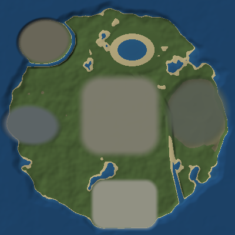

# Phase 3 — World & map generation (Siran Island greybox)

**Scope: terrain, water, roads and coloured zone markers. No buildings, no
houses, no monuments, no props, no trees.** Phase 3 exists to prove that a 4 km
island can be streamed and drawn at 30 FPS on a Unisoc T606 — geometry that does
not serve that goal is deliberately absent.

Target hardware and budget: `docs/UNISOC_BUDGET.md`.
Device runbook: `docs/PHASE3_ACCEPTANCE.md`.

---

## 1. What ships

| Thing | Where | Notes |
| --- | --- | --- |
| Layout data (zones, lake, river, moat, roads, seed) | `scripts/world/siran_map_config.gd` | The single source of truth. Code, not a `.tres`, so a bad merge cannot move the runway. |
| Zone / water / road / channel resources | `scripts/world/island_*.gd` | Typed `Resource`s, usable from the inspector, serialisable later. |
| Heightfield generator (FastNoiseLite) | `scripts/world/bake/island_heightmap.gd` | **Bake-time only.** |
| Mesh + collision builders | `scripts/world/bake/terrain_mesh_builder.gd`, `surface_mesh_builder.gd` | **Bake-time only.** |
| Baker that writes the files | `scripts/world/bake/island_baker.gd` | **Bake-time only.** |
| `bash tools/bake_siran_island.sh` | `tools/` | Import → bake → self-check, one command. |
| Streaming | `scripts/world/chunk_manager.gd` | 500 m chunks, threaded loads, radius driven. |
| World scene | `scenes/world/siran_island.tscn` | Ocean, lake, river, streamer, camera, HUD. |
| Terrain / road materials | `resources/world/materials/*.tres` | Unshaded `ShaderMaterial`, no PBR. |
| Water shader + ripples | `assets/shaders/water_surface.gdshader`, `assets/textures/water_normal_256.png` | Unshaded, one scrolling normal map sampled twice. |
| Self-check | `scenes/tests/phase3_selfcheck.tscn` | Layout maths + collision-vs-mesh raycasts. |
| Static gates | `tools/verify_phase3.sh` | `bash tools/verify_phase3.sh` |

The baked outputs (`scenes/world/terrain/*.tscn`, `resources/world/terrain/*.res`,
`resources/world/baked/*`) **are committed** once produced — a fresh clone runs
without baking. See §6.

---

## 2. The island

World space: metres, X = east, Z = south, Y = up, map centred on the origin.
4000 × 4000 m, sea level `y = 0`, sampled every 10 m (401 × 401 samples).

```
cz\cx    0     1     2     3     4     5     6     7      (cx grows east)
 0       .     .     .     .     .     .     .     .
 1       .    [F]    .     .    (~)    .     .     .        F  Factory Island / Iron Mill
 2       .    [F]    .     .     .     .     .     .        ~  Siran Lake
 3       .     .     .     .    [C]    .     .    [G]       C  Central State
 4       .    [D]    .     .     .     .     .     .        G  Graveyard Center
 5       .     .     .     .     .    |      .     .        D  Dock Island / Konkan Docks
 6       .     .     .     .    [A]   |      .     .        A  Aircraft Industry
 7       .     .     .     .     .    |      .     .        |  River
```



*Design reference only.* This 400 m/px render was made from the layout maths
(island mask, zone pads, lake, river, moat) before the Godot bake existed, to
check that the pads land on land and the water bodies hold water. It is **not**
the bake output and is not used at runtime — the authoritative picture is
`docs/images/siran_island_preview.png`, written by
`tools/bake_siran_island.sh` from the real FastNoiseLite heightfield.

Schematic only — every number below is the authoritative one.

| Zone | Kind | Centre (x, z) | Footprint | Bake height | Flatness | Feather |
| --- | --- | --- | --- | --- | --- | --- |
| Factory Island — Iron Mill | `INDUSTRIAL` | (-1250, -1300) | ellipse 760 × 640, -12° | 26.0 m | 1.00 | 90 m |
| Dock Island — Konkan Docks | `DOCK` | (-1470, 130) | ellipse 780 × 540, 6° | 4.5 m | 1.00 | 110 m |
| Central State — Urban | `URBAN` | (40, -30) | rounded rect 1150 × 1150, r 253 | 16.0 m | 0.72 | 170 m |
| Graveyard Center — Foggy Hills | `GRAVEYARD` | (1350, -80) | ellipse 820 × 900, 12° | 42.0 m | 0.55 | 190 m |
| Aircraft Industry — Hangars & Runway | `AIRFIELD` | (120, 1480) | rounded rect 1020 × 740, r 163 | 12.0 m | 1.00 | 90 m |

`flatness` is how hard the baker pulls the ground towards `bake height`:
1.0 is a machined pad, 0.72 keeps *gentle* slopes in the city, 0.55 lets the
graveyard stay properly hilly.

Water:

| Body | Where | Surface | Details |
| --- | --- | --- | --- |
| Sea | everywhere off the coast | 0.0 m | One 4600 m plane; the coastline noise moves the shore ±170 m around r = 1950 m. |
| Siran Lake | (250, -1150), ellipse 520 × 380 | 9.0 m | Baked bowl, 11 m deep at the centre, 80 m shore feather. |
| Siran River | lake outlet → south-east coast | 9.0 → -0.5 m | 9-point centreline, 70 → 110 m wide, 2.8 m deep, 24 m banks. **Descending** surface, not a flat plane. |
| Iron Mill channel | ring around Factory Island, 490 × 430 | 0.0 m | 34 m half-width, 4.5 m below sea. Cuts the factory loose as an island; the causeway road crosses it. |

Five roads (16 m asphalt + 7 m shoulder), all graded and causeway-safe:

```
Konkan Docks ──────── Central State ──────── Aircraft Industry
                        │      │                    │
Iron Mill ──────────────┘      └──────── Graveyard  │
                        └──────────── Coast Highway ─┘  (Airbase → Docks)
```

---

## 3. Generation pipeline (bake time)

`IslandHeightmap.generate()` runs seven passes, in this order, because the order
is what makes the result predictable:

| # | Pass | What it does | Why the order matters |
| --- | --- | --- | --- |
| 1 | Island mask | Radial falloff whose radius is wobbled by coastline noise; `smoothstep(inland × 8)` | Gives an irregular shore with an ~80 m beach band instead of a circle. |
| 2 | Land height | FBM hills (domain-warped) + ridged spines, boosted by the Graveyard zone weight | East side gets real hills (42 m ± ~25 m), the rest rolls. |
| 3 | Water carve | Lake bowl, river channel (parabolic cross-section), moat | Carves only *down* (`min`), so existing hills survive as banks. |
| 4 | Smooth | One 3×3 Gaussian pass | Kills single-sample spikes before anything else snaps to a plane. |
| 5 | Zones | `h = lerp(h, zone.flat_height, flatness × weight)` | Flattening after smoothing means pads stay flat and their edges stay soft. |
| 6 | Roads | Corridor graded to a smoothed, grade-clamped profile; hoisted ≥ 1.2 m over any water | Road profiles are sampled *after* the zones, so a road meets the runway at the runway's height. |
| 7 | Hard flats | Zones with `flatness == 1` are re-stamped exactly | This is why the runway is *perfectly* flat even where the access road joins it. |

Then normals are computed with central differences on the global grid (not per
chunk), so a normal on a chunk border is identical in both neighbours — no
visible lighting seam.

**Verify the shape without opening Godot:** the bake writes
`docs/images/siran_island_preview.png`, a 512 × 512 top-down colourised
hillshade with the 8 × 8 chunk grid drawn on top, plus the per-zone
min/max/flat-deviation table printed to the console and stored in
`resources/world/baked/siran_island_summary.tres`.

---

## 4. Collision: HeightMapShape3D, never a trimesh

The requirement is hard: **no `ConcavePolygonShape3D` for terrain.**

| | `ConcavePolygonShape3D` (trimesh) | `HeightMapShape3D` (what we use) |
| --- | --- | --- |
| Build cost per chunk | BVH over 5 000 triangles, ~40–90 ms | ~1 ms, one heightfield |
| Physics memory per chunk | ~90 KB + broadphase entries per triangle | ~10 KB, one AABB tree node |
| Query cost | Triangle soup, cache-hostile | Direct cell lookup |

How it is set up (`scripts/world/bake/terrain_mesh_builder.gd`):

* `map_width == map_depth == 51` and `map_data[z * 51 + x]` in row-major order.
* The chunk's `CollisionShape3D` is scaled `(10, 1, 10)` — a height field's cells
  are always 1 m in engine units, so the node scale is what makes them 10 m of
  world. **X and Z must stay equal.**
* Jolt silently falls back to a triangle mesh when `width != depth` or
  `width / 2 < 2`, so the builder asserts both. (Godot 4.4, `JoltHeightMapShape3D::_build`.)
* The chunk's vertices span `±(51-1)/2 × 10 = ±250 m` in mesh space and the same
  in shape space, with the chunk root at the chunk centre — so the picture and
  the collider are the same surface by construction.

That claim is not taken on faith: `scenes/tests/phase3_selfcheck.tscn` fires 25
rays straight down at known mesh vertices of a baked chunk and compares the hit
height with the vertex height (tolerance 0.6 m for triangle-edge interpolation).

---

## 5. Chunk streaming

```
500 m chunk = 51 × 51 vertices = 2 601 verts / 5 000 triangles
8 × 8 chunks = 64 scenes, 166 464 vertices, 320 000 triangles for the whole island
```

`ChunkManager` (`scripts/world/chunk_manager.gd`):

* Rebuilds the desired set when the focus crosses a chunk border (not every
  frame): 64 rectangle tests, then sorted **nearest first**.
* Starts at most `max_loads_in_flight = 2` `ResourceLoader.load_threaded_request(
  path, "PackedScene", true)` at a time. `load_threaded_get_status()` is polled
  on the same 5 Hz tick; `load_threaded_get()` runs on the main thread.
* Frees at most `unloads_per_tick = 2` chunks outside the radius.
* Loads the focus chunk synchronously on the first tick, so the player never
  spawns into a hole.
* If `scenes/world/terrain/chunk_x_y.tscn` is missing it says so **once**, with
  the command that fixes it — a bake-less clone shows the ocean and a warning,
  not a silent void.

### The 50 m radius, honestly

The spec says "load only the chunks within a 50 m radius; unload outside it".
With 500 m chunks that literal rule loads **one** chunk and leaves the player
looking at the void 250 m in every direction — correct per the letter, unplayable
per the intent. So the radius is implemented exactly as specified and *plus* a
safety floor:

* `stream_radius_m = 50.0` decides every chunk beyond the floor;
* `keep_ring = 1` keeps the 3 × 3 chunks around the focus chunk resident
  (9 chunks, ~1.5 MB of mesh). At a map corner the ring clamps to 4.

`stream_radius_m` is an exported property on the `ChunkManager` node. Once Phase 4
adds landmarks to hide the edge behind, raise it to ~600–900 and set
`keep_ring = 0`; the self-check covers both cases (`compute_desired_for()`).

### Draw calls per frame

| Item | Draw calls |
| --- | --- |
| 9 resident terrain chunks | 9 |
| Road ribbons in those chunks | 0–9 |
| Ocean + lake + river | 3 |
| HUD | ~3 |
| **Worst case** | **~24** (budget 60) |

---

## 6. Baking

```bash
bash tools/bake_siran_island.sh                  # 10 m samples, 500 m chunks
bash tools/bake_siran_island.sh --spacing=5     # 4× the vertices, 4× the repo
GODOT_BIN=~/Godot_v4.4-stable_linux.x86_64 bash tools/bake_siran_island.sh
```

Needs a Godot **4.4+** binary with the project importable; there is no offline
substitute, because the heightfield comes from `FastNoiseLite` inside the engine.
The wrapper does three things and stops on the first failure:

1. `godot --headless --path . --import` — builds `.godot/` and generates the
   sidecar files the project needs but cannot generate on another machine:
   `assets/textures/water_normal_256.png.import` and the `*.gd.uid` files Godot
   4.4 writes next to every script. **Commit both** after the first run (the
   `.import` file is the import contract — see `docs/ASSET_PIPELINE.md` §2 —
   and stable script UIDs keep scene references stable);
2. `godot --headless --path . --script res://tools/bake/bake_siran_island.gd`;
3. `godot --headless --path . scenes/tests/phase3_selfcheck.tscn -- --require-bake`.

Alternatively open `tools/bake/bake_siran_island_editor.gd` in the editor and
press **File > Run** — same code, same output.

Expected output (10 m samples):

| Artefact | Count | Size each | Total |
| --- | --- | --- | --- |
| `scenes/world/terrain/chunk_<x>_<y>.tscn` | 64 | ~1.5 KB | ~100 KB |
| `resources/world/terrain/chunk_<x>_<y>_mesh.res` | 64 | ~160 KB | ~10 MB |
| `resources/world/terrain/chunk_<x>_<y>_collision.res` | 64 | ~10 KB | ~0.7 MB |
| `resources/world/terrain/chunk_<x>_<y>_road.res` | ~20 | varies | < 0.1 MB |

The bake prints the real numbers and the per-zone integrity table. **Commit the
outputs together with any change to the generator** — `siran_island_summary.tres`
stores `generator_version`, and the HUD plus `verify_phase3.sh` both shout when
the chunks on disk are older than the code (`docs/PHASE3_WORLD.md` §9).

A `.res` mesh is a binary resource: reviewable diffs are for `.gd`/`.tscn`/`.tres`,
not for 160 KB of float data. If the repo weight ever becomes a problem, the next
step is Git LFS for `*.res` (`.gitattributes` currently LFS-tracks only
`png/jpg/glb/ogg/wav/exr`), not committing less of the map.

---

## 7. Budget accounting (Phase 3, at the 50 m default)

| Budget | Limit | Phase 3 worst case |
| --- | --- | --- |
| Draw calls | 60 | ~24 |
| Triangles resident | – | 45 000 (9 chunks) |
| Mesh VRAM | 180 MB | ~1.5 MB of vertex/collision data, one 256² texture (~32 KB ASTC) |
| Textures | ≤ 512² | `water_normal_256.png` (256²) — terrain is vertex-coloured, zero textures |
| Lights per object | 2 | 0 shading lights (unshaded materials); one shadowless `DirectionalLight3D` kept for Phase 4 |
| Physics | 30 Hz | 9 height fields, no trimeshes |
| Runtime generation | none | none — the streamer only instantiates scenes |

---

## 8. Materials

* **Terrain + roads**: `assets/shaders/terrain_greybox.gdshader`, `render_mode
  unshaded`. Colour comes from baked vertex colours (`IslandHeightmap.color_at`):
  biome palette (bed / wet sand / sand / grass / scrub / rock) blended with the
  zone tint, plus runway markings. One directional term from the vertex normal,
  two `sin()` calls of grain, and a cheap distance haze. No PBR, no specular, no
  shadows, no screen textures — a Mali-G57 MP1 notices all four.
* **Water**: `assets/shaders/water_surface.gdshader`, `render_mode unshaded`,
  opaque. One 256² tiling normal map sampled twice at different scales and scroll
  speeds gives the moving ripple; a fresnel mix to sky colour and a single
  specular blob give it a surface. Three materials share it (ocean, lake, river)
  with different colours and flow speeds.
* **Zone markers** are the terrain's vertex colours, so a zone costs **zero**
  draw calls. The five pads are also why the map is readable from the air during
  a streaming test.

The specification allowed "a simple 1.5K texture **or** vertex colour" for the
terrain. The Unisoc budget caps textures at 512² (a 1536² texture is 9× the
area of a 512² and roughly 1.5 MB of VRAM before compression), so vertex colour
wins: the terrain is completely texture-free, and the only texture in the whole
world is the 256² water normal map.

---

## 9. Changing the map

* **A zone's position/size/height** — edit `SiranMapConfig.default_siran_island()`.
* **A new zone** — add one `_make_zone(...)` entry, pick a `Kind` (it selects the
  tint and, for `AIRFIELD`, the runway markings), then re-bake.
* **Terrain character** — `island_radius_m`, `coastline_noise_m`, and the noise
  amplitudes in `IslandHeightmap.base_height()`. Bump `generator_version`
  whenever the *math* changes, so stale bakes are caught.
* **Resolution** — `--spacing=5` quadruples the repo size for sharper slopes;
  `--spacing=20` halves it. Both are validated against the chunk size, so a
  chunk that is not a whole number of cells fails the bake instead of producing
  seams.
* **Streaming** — `stream_radius_m` / `keep_ring` on the `ChunkManager` node.

## 10. Known greybox limitations (deliberate)

1. Roads crossing the river become **causeways** (the corridor is raised 1.2 m
   over the water). Real bridges are Phase 4.
2. The Iron Mill channel is 34 m wide: the causeway over it is a solid embankment
   with no railings and no span.
3. Terrain has no collision seam fix-up at chunk borders because the grids are
   shared — but chunk *unload* while standing on the boundary is handled by
   `keep_ring ≥ 1`, not by merging bodies.
4. No LOD: every chunk is one resolution. With a 50 m radius that is fine; a
   1000 m radius will want a second, coarser chunk tier (Phase 5).
5. Water is opaque: no shoreline transparency, no depth fade. One plane, one
   shader, three draw calls.
6. No trees, rocks or cover props — Phase 4.
